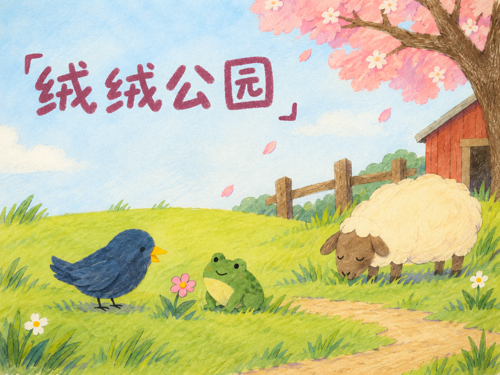

# 绒绒公园

《绒绒公园》是一款轻松的春日像素探索游戏。你会扮演一只小乌鸦，在农场里四处走走，帮助白鸡、青蛙、小羊、渡渡鸟、鸵鸟和稻草人完成各自的小委托。

游戏没有战斗，也不用赶时间。你会玩到猜拳、数字猜谜、飞行器迷宫、寻找物品等几段短小游戏。每帮助一位朋友，对方就会前往谷仓等待。集齐六位朋友后，可以进入谷仓，与中央书架互动，翻看大家最后的合照。

这不是一个很长的游戏，更像一段慢悠悠的春日散步。樱花会不断飘落，路边的花草和树冠会随风轻轻晃动，朋友们也会在完成任务后自己走向谷仓。

## 操作

- 移动：方向键或 WASD
- 交互、确认：Z、空格或 Enter
- 取消小游戏、关闭画页：X、Esc 或 Tab
- 声音开关：开始页右下角按钮

开场动画结束后角色就可以移动。结尾合照打开时游戏会暂停，点击“收好这张画”或按取消键即可继续。

## 运行工程

当前工程已适配 **Godot 4.7.2**，无需再执行 Godot 3 转换。

1. 下载或克隆本仓库。
2. 在 Godot 项目管理器中选择“导入”。
3. 打开仓库根目录下的 `project.godot`。
4. 进入编辑器后按 **F5** 运行游戏。

游戏使用 192×144 逻辑分辨率和整数倍缩放，以保持像素画边缘清晰。

## 当前版本做了什么

- 将原 Godot 3 工程迁移到 Godot 4，并修复旧接口、窗口缩放、着色器和场景资源问题。
- 增加中文开始页、声音开关和统一的插画风格 UI。
- 为标题、飘落花瓣、前景花草和樱花树冠加入轻微动态效果。
- 调整动物朋友前往谷仓时的行走表现。
- 重绘水井和按键提示，并给水井增加接地阴影。
- 增加谷仓结尾合照和蜡笔风制作致谢页。

## 原作与致谢

本项目基于 Jon Topielski 与 mellorine 为 Cozy Autumn Game Jam 2022 制作的 [Feather Park](https://github.com/jontopielski/cozy-autumn)，在其基础上完成了 Godot 4 适配、中文界面和春日视觉调整。

- 原作、游戏美术及素材：Jon Topielski
- 音乐：mellorine — *Bird of a Feather*、*Flock Together*
- 中文 UI 字体：[荆南麦圆体](https://github.com/maoken-fonts/KNMaiyuan)，采用 SIL Open Font License
- 封面与结尾插画：ChatGPT 图像生成，并经过人工选择与调整

本仓库记录的是学习性质的技术适配与视觉修改。原作代码、美术和音乐的权利仍归各自作者；仓库中没有附带原作者对参赛、商业使用或再次发行的额外授权。如需用于这些场景，请先联系原作者确认许可。
